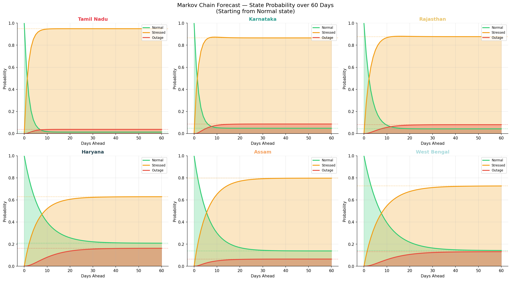

# Power Grid Outage-Risk Modeling

A research project exploring weather- and demand-related grid stress across six Indian states. It combines rule-based stress classification with Markov-chain and Bayesian calculations, then produces Python and MATLAB visualizations.

> **Scope:** This is an academic prototype, not an operational forecasting tool. Its “outage” class is inferred from demand and weather stress thresholds; the project does not use a verified record of actual outage events. Results should not be interpreted as validated outage forecasts.

## What it does

- Collects daily weather data from NASA POWER and state-level demand data from the POSOCO/GRID-INDIA dataset.
- Classifies grid conditions as **Normal**, **Stressed**, or **Outage** using configurable weather and demand thresholds.
- Builds global and seasonal Markov transition matrices and estimates steady-state probabilities.
- Applies a Bayesian weather adjustment and uses Poisson and exponential distributions for illustrative outage-count and duration estimates.
- Generates summary plots, state-specific MATLAB plots, prediction dashboards, and an interactive map.

The six states in the supplied configuration are Assam, Haryana, Karnataka, Rajasthan, Tamil Nadu, and West Bengal.

## Results preview

Example Markov-chain trajectories produced by the Python pipeline:



The repository also includes an [interactive risk map](plots/india_power_outage_risk_map.html) and additional Python and MATLAB figures.

## Repository layout

```text
.
├── config.py
├── run_pipeline.py
├── step1_fetch_weather.py
├── step2_fetch_grid_data.py
├── step3_classify_states.py
├── step4_markov_model.py
├── step5_bayesian_update.py
├── step6_prediction_engine.py
├── step7_visualizations.py
├── step8_map_visualization.py
├── markov_analysis.m
├── predict_outage.m
├── requirements.txt
├── data/                 # Pipeline input and intermediate CSV files
├── models/               # Generated model summaries and transition matrices
├── plots/                # Python plots and interactive map
├── plots_matlab/         # MATLAB analysis and prediction figures
└── results/              # Example prediction output
```

## Run the Python pipeline

Python 3.10 or later is recommended.

```powershell
py -m venv .venv
.\.venv\Scripts\Activate.ps1
python -m pip install -r requirements.txt
```

Run the full pipeline (downloads fresh source data):

```powershell
python run_pipeline.py
```

Run using the CSV files already in `data/`:

```powershell
python run_pipeline.py --skip-fetch
```

Predict for a chosen state and date using the generated models:

```powershell
python run_pipeline.py --predict-only --state "Rajasthan" --date 2024-05-20 --days 30 --temp 45 --rain 0 --wind 10
```

The full pipeline writes model files to `models/`, plots and the interactive map to `plots/`, and prediction output to `results/`. The command-line options are also listed by `python run_pipeline.py --help`.

### MATLAB

Open `markov_analysis.m` or `predict_outage.m` in MATLAB. For example:

```matlab
predict_outage('Rajasthan', '2024-05-20', 45, 0, 10, 30)
```

## Data sources

- **Weather:** [NASA POWER](https://power.larc.nasa.gov/), daily weather observations.
- **Electricity demand:** [POSOCO/GRID-INDIA data](https://robbieandrew.github.io/india/data/POSOCO_data.csv), sourced by the project’s data-fetching script.

The supplied CSVs are retained so the pipeline can be explored without downloading data first. Use `--skip-fetch` to use them. Upstream data can change; verify the source terms and attribution requirements before redistributing or refreshing datasets.

## Method and assumptions

The classification combines weather stress and demand stress with weights defined in `config.py` (currently 0.45 and 0.55). Markov transition matrices are estimated from consecutive classified daily states. The Bayesian adjustment uses season-level priors and likelihood assumptions, while the duration model uses state-specific values documented in the prediction code.

These are modeling assumptions, not empirically validated outage labels or guarantees. Thresholds, data availability, missing values, and upstream updates can materially affect results. Review the source and assumptions before drawing conclusions.

## Reuse

No license is included. Add a license only after deciding how you want the code and data to be reused, and confirming that you have the right to publish each included dataset.
